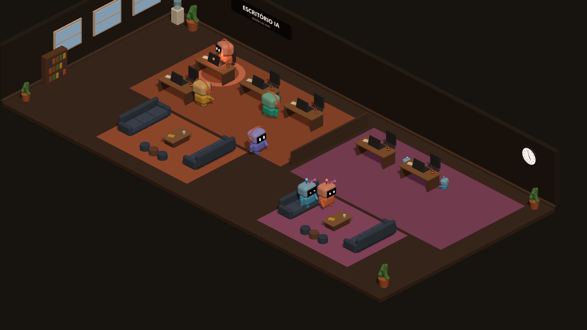

# Escritório IA

Um escritório 3D que mostra, ao vivo, cada conversa aberta com IA como um bonequinho numa mesa.
Quando você manda um pedido, ele levanta do sofá e vai trabalhar. Quando a IA pede permissão, ele acena.
Quando termina, ele comemora e volta a descansar.



Não tem campo de chat nem conta pra criar: o coletor só **lê** os arquivos que as ferramentas de IA já gravam no seu PC
e desenha o que está acontecendo. Roda 100% na sua máquina, sem `npm install`, sem nuvem.

## Sumário

- [O que ele mostra](#o-que-ele-mostra)
- [Ferramentas suportadas](#ferramentas-suportadas)
- [Instalação](#instalação)
- [Duas ou mais pessoas na mesma rede](#duas-ou-mais-pessoas-na-mesma-rede)
- [Configurações](#configurações)
- [Privacidade e segurança](#privacidade-e-segurança)
- [Atualização automática assinada (opcional)](#atualização-automática-assinada-opcional)
- [Estrutura do código](#estrutura-do-código)
- [Limites conhecidos](#limites-conhecidos)

## O que ele mostra

| Estado | Como aparece |
|---|---|
| Descansando | O boneco fica no sofá, sonolento. |
| Pedido | Ele vai até a mesa com um balão mostrando o que você pediu. |
| Trabalhando | "pensando…" ou o nome da ferramenta em uso, notebook aceso, luz no chão e, de vez em quando, um gole de óleo de máquina. |
| Esperando você | A IA pediu permissão ou fez uma pergunta: ele levanta a mão e acena, com balão e luz âmbar piscando. |
| Ajudantes | Subagentes viram bonequinhos menores digitando ao lado da mesa (até 4). |
| Pronto | Um pulinho, "✓ pronto", e ele volta pro sofá. |

Além disso:

- **Detalhe da sessão:** clique num boneco ou numa mesa pra ver estado, tempo, ferramenta, último pedido, última resposta, ajudantes e tokens.
- **📊 Hoje:** pedidos, tempo de trabalho da IA, ferramentas mais usadas, tokens e uma linha do tempo das últimas 3 horas.
- **Avisos:** aviso na página, som e notificação do Windows quando a IA precisar de você ou terminar.
- **Dia e noite:** a luz da sala segue o relógio. Sem ninguém trabalhando por 10 minutos, o escritório "dorme".
- **Visual por pessoa:** cada um escolhe a cor da sua ala e um acessório pros bonecos (boné, óculos, laço, fones, coroa).
- **Celular:** o layout se ajusta à tela e dá pra adicionar à tela inicial como app.

## Ferramentas suportadas

| Ferramenta | De onde lê | Cor |
|---|---|---|
| Claude Desktop (aba Code) | `~/.claude/projects/**/*.jsonl` | laranja |
| Claude Code no terminal | mesmo lugar | amarelo |
| Apps feitos com o Claude Agent SDK | mesmo lugar | verde-água |
| Antigravity | `~/.gemini/antigravity/` (SQLite) | roxo-azulado |
| Gemini CLI | `~/.gemini/tmp/<projeto>/chats/` | azul-claro |

As conversas são só lidas, nunca alteradas.

## Instalação

### Requisitos

- **Node.js 22.13 ou mais novo** (usa o `node:sqlite` embutido). Baixe a versão LTS em [nodejs.org](https://nodejs.org).
  Se preferir não instalar, coloque o Node portátil numa pasta `node\` dentro do projeto (`node\node.exe`), que ele é usado primeiro.
- Windows 10/11 para a bandeja e a inicialização automática. Em macOS e Linux o coletor roda pelo terminal (veja abaixo).

### 1. Baixar

```bash
git clone https://github.com/rluuan/escritorio-ia.git
```

Ou, sem Git: botão **Code → Download ZIP** aqui no GitHub e extraia em qualquer pasta.

### 2. Abrir (Windows)

Dê dois cliques num destes arquivos:

| Arquivo | O que faz |
|---|---|
| `ativar-inicializacao.cmd` | **Recomendado.** Abre agora e toda vez que o Windows ligar, sem janela, com um ícone perto do relógio. |
| `iniciar-na-bandeja.cmd` | Abre só desta vez, com o ícone perto do relógio. |
| `iniciar.cmd` | Abre numa janela de terminal (bom pra ver o que está acontecendo). |

Na primeira vez ele pergunta **o nome que vai aparecer no escritório**. Se o Windows ou o antivírus perguntar sobre o firewall,
permita (só é preciso se você quiser abrir pelo celular ou juntar outro PC).

No ícone da bandeja (botão direito): **Abrir escritório**, **Ver registro**, **Reiniciar** e **Sair**.
Pra não abrir mais com o Windows: `desativar-inicializacao.cmd`.

### 2. Abrir (macOS / Linux)

```bash
cd escritorio-ia
OWNER="Seu nome" node server.mjs
```

### 3. Usar

Abra **http://localhost:4480**. Pra ver só a animação de exemplo, sem ler nada do seu PC: **http://localhost:4480/?demo=1**.

Abra uma conversa no Claude, no Antigravity ou no Gemini CLI e mande um pedido: o boneco dela aparece e vai pra mesa.

### 4. (Opcional) Aviso exato de "esperando você" no Claude

Por padrão o escritório **estima** quando o Claude está esperando você (perguntas e aprovação de plano são sempre detectadas;
Edit/Write parados por mais de 5 s contam como "talvez esperando permissão").

Pra aviso exato: **⚙ Configurações → Instalar hook**. Ele acrescenta um hook de notificação em `~/.claude/settings.json`
(e antes guarda uma cópia em `settings.json.antes-escritorio-ia`). O hook só repassa o aviso pro coletor e nunca trava o Claude.
**Remover hook** desfaz.

## Duas ou mais pessoas na mesma rede

Cada PC roda o seu próprio coletor (cada um só lê os próprios arquivos). Os coletores se acham sozinhos pela rede local
e trocam as sessões, então **qualquer endereço mostra o escritório inteiro**, com uma ala por pessoa.

1. Instale o projeto em cada PC, como acima, cada um com o seu nome.
2. Defina **o mesmo PIN** nos dois (⚙ Configurações → PIN da casa).
3. Pronto. Cada PC também anuncia um nome fixo na rede: `http://escritorio-<nome>.local:4480`.

Portas usadas: TCP 4480 (página e troca de sessões), UDP 4478 (descoberta) e UDP 5353 (nome `.local`).

Se a descoberta não funcionar (alguns roteadores bloqueiam broadcast), coloque o endereço do outro PC em `peers` no `config.json`:

```json
{ "owner": "Ana", "port": 4480, "peers": ["http://192.168.1.20:4480"] }
```

### No celular

Abra `http://escritorio-<nome>.local:4480` (ou o IP do PC). No iPhone, "Compartilhar → Adicionar à Tela de Início".
No Android, pelo menu do Chrome. Alguns Androids não entendem `.local`; aí use o IP.

## Configurações

O arquivo `config.json` é criado na primeira vez que você abre (veja `config.exemplo.json`). Quase tudo também dá pra mudar em ⚙ Configurações.

| Campo | Padrão | O que é |
|---|---|---|
| `owner` | nome do usuário do Windows | Nome que aparece no escritório. |
| `port` | `4480` | Porta da página. |
| `showText` | `true` | Mostrar o texto dos pedidos pros outros PCs. Desligado, a rede vê só os bonecos e os estados. |
| `peers` | `[]` | Endereços de outros PCs, se a descoberta automática não funcionar. |
| `pin` | vazio | PIN da casa (4 a 8 números). |
| `cor`, `acessorio` | | Visual da sua ala. |

Variáveis de ambiente: `PORT` e `OWNER` sobrescrevem o `config.json`.

## Privacidade e segurança

- **Nada sai da rede local.** Não há servidor externo, telemetria nem conta.
- **PIN:** quem abrir o escritório por outro aparelho precisa digitar o PIN. No próprio PC ele nunca é pedido.
  Cinco erros seguidos bloqueiam aquele aparelho por 1 minuto. Entre os coletores, o PIN viaja em hash.
- PIN, visual, texto na rede e hook só podem ser mudados pela página aberta no próprio PC (`localhost`).
- O coletor só grava os próprios arquivos (`config.json`, `escritorio.log`, `versao.json`) e, se você pedir pelo botão, o hook no `settings.json` do Claude.
- Se o antivírus reclamar do `bandeja.ps1` (um script PowerShell que abre sem janela), use o `iniciar.cmd`, que faz a mesma coisa numa janela.

## Atualização automática assinada (opcional)

Útil quando você instala o escritório em mais de um PC e quer mexer no código num só.
Quando dois PCs se conectam, eles comparam a versão; o mais antigo baixa os arquivos novos do outro e reinicia sozinho.

1. No PC onde você mexe no código, rode uma vez:
   ```bash
   node gerar-chave.mjs
   ```
   Isso cria `chave-privada.pem` (fica só nesse PC, **nunca envie nem suba pro Git**) e `chave-publica.pem`.
2. Copie o `chave-publica.pem` pra pasta do escritório nos outros PCs.
3. A cada vez que o PC com a chave privada abre o escritório e algum arquivo mudou, ele assina uma versão nova sozinho.

Os outros PCs recusam qualquer arquivo sem a assinatura certa ou fora da lista permitida
(`server.mjs`, `hook.mjs`, `bandeja.ps1`, `README.md`, `lib/*.mjs` e `public/*`). Os `.cmd`, o `config.json`,
as chaves e a pasta `node` nunca são trocados. Sem `chave-publica.pem`, a atualização automática fica desligada.

## Estrutura do código

```
server.mjs          junta os módulos e cuida das rotas HTTP
hook.mjs            chamado pelo hook do Claude; só repassa o aviso
gerar-chave.mjs     cria o par de chaves da atualização assinada
bandeja.ps1         ícone na bandeja do Windows e supervisor do coletor
lib/nucleo.mjs      sessões, estatísticas do dia e linha do tempo
lib/claude.mjs      leitor do Claude ("esperando você", subagentes, tokens)
lib/antigravity.mjs leitor do Antigravity
lib/gemini.mjs      leitor do Gemini CLI
lib/rede.mjs        descoberta e troca de sessões entre PCs
lib/mdns.mjs        nome .local na rede
lib/atualizacao.mjs atualização assinada (ed25519)
lib/acesso.mjs      PIN e controle de acesso
lib/hook.mjs        instala e remove o hook do Claude
public/             página: index.html, estilo.css, cena.js (Three.js), ui.js (painéis)
tests/              testes com amostras montadas, nenhuma conversa real
```

Rodar os testes:

```bash
node --test tests/escritorio.test.mjs
```

Tudo usa só módulos embutidos do Node (`node:sqlite`, `node:test`, `dgram`, `crypto`, `fs.watch`). A página carrega o Three.js por CDN.

## Limites conhecidos

- Claude no navegador (claude.ai), Gemini no navegador e o ChatGPT não gravam as conversas no PC, então não aparecem.
- Gemini CLI: o leitor foi montado a partir do formato do arquivo e testado com amostras, ainda não com uma conversa real.
- No Antigravity o texto do pedido vem de um formato interno; se uma atualização mudar esse formato, o boneco continua
  funcionando, mas o balão pode vir vazio.
- Com o hook, depois de você aprovar um comando demorado, o boneco pode continuar "esperando" até o comando terminar.
